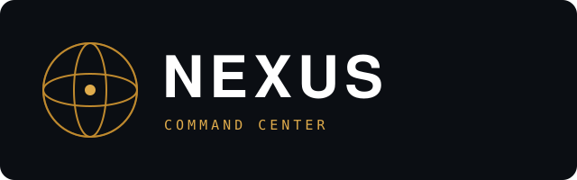
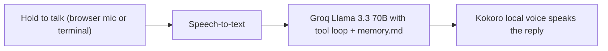

  
  <h1>Nexus</h1>

  
<strong>A personal voice AI assistant that runs on a $0 budget.</strong>

     

> **Showcase repository.** The source code for Nexus is not published. This page presents what the product is and how it works.

## Overview

A Jarvis-style voice assistant that listens, remembers facts about you, controls your Mac and grows new tools over time, powered by free-tier services and local models.

## How it works

## Features

- Terminal and web "Command Center" interfaces
- Persistent memory file read on every turn
- Mac control tools: open apps, screenshots, AppleScript, shell
- Local offline voice (Kokoro) and live CPU/RAM/battery telemetry
- Hands Mode gesture control (MediaPipe), Face Mode overlay
- High-fidelity HUD design handoff included (`design/`)

## Tech stack

| Layer | Choice |
|---|---|
| Language | Python (Flask web UI) |
| Brain | Groq (Llama 3.3 70B), free tier |
| Voice | Kokoro (local), Web Speech API |
| UI | HTML/CSS/JS canvas HUD, Space Grotesk + JetBrains Mono |

## Privacy & security

Runs locally; only model calls go to Groq. API keys are kept out of the project files.

## Brand

| | Name | Hex | Role |
|---|---|---|---|
|  | Background | `#0B0E13` | App background |
|  | Panel | `#1E2836` | Panels |
|  | Gold | `#C08A2E` | Primary accent |
|  | Gold Light | `#E0AC4C` | Glow / highlight |
|  | Online | `#7FBF8F` | Status good |

**Mark.** Gold-on-obsidian command-center HUD with a rotating AI-core globe.

**Voice.** Futuristic, sharp and a little cocky.

## Roadmap

- Wire Conversations and System Log to real data
- Port the Command Center design into the app

## License

Proprietary. Shared publicly for portfolio and demonstration purposes only. See [LICENSE](LICENSE).

---

Built by [Aquila Digital LLC](https://github.com/Steven6Brown) · *Per Aspera Ad Astra*

